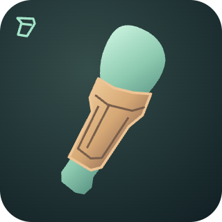

# Arm Room

Fit cosplay forearm shells, biceps, elbow plates and shoulder bells inside OrcaSlicer. Start with a guided arm profile, an upright arm scan, or the included Mandalorian shoulder by dromanol.

## Try it

Subscribe to [Arm Room on the OrcaSlicer Plugin Hub](https://cloud.orcaslicer.com/p/468422fa52d1), then refresh **File → Plugins** and activate **Arm Room**. For local installation, select **Install local plugin** and choose [arm_room_any.py](dist/arm_room_any.py). The [standalone preview](dist/preview.html) also works offline in a desktop browser after download. Browser and Orca libraries are separate.

1. Choose **Forearm & wrist**, **Upper arm & elbow**, or **Shoulder** and pick the side. For a quick tour, choose **Shoulder → Try the Mandalorian shoulder**.
2. **Measure my arm** asks for three to six measurements over the layer you plan to wear. Give forearm length, wrist and forearm circumference, and the distance to the fullest part. A slide-on cuff also asks for tucked-hand width and thickness. Upper-arm fits use length, bicep and elbow circumference. Shoulders use upper-arm length, bicep circumference, the loop through the armpit and shoulder drop. **Use arm scan** accepts a region-specific STL in millimetres, with its wrist end down and its front toward −Y.
3. Import a shell or add multipart armor. Move, rotate, scale and inspect three adjustable sections. The hand-entry oval approximates the thickest section of a tucked hand. Foam previews show two pads over the front and back of the arm. Measure point-to-point clearance in any section.
4. For shoulders, expand **Shoulder overlap**. Add an upright chest STL, or open a fit in Chest Room 0.1.1 and use **Precise alignment → Save shoulder reference for Arm Room**. The reference carries both fitted plates and the measured torso’s shoulder landmarks. Review arm-down, forward-reach and raised-arm poses. These rigid previews approximate movement; soft straps, tissue and sliding plates can move differently on a wearer.
5. **Save fit…** keeps a named version. **Open plate in OrcaSlicer** sends only the selected fitted piece. The standalone preview downloads the same STL. Existing profiles and saved fits remain available when a measured profile is revised.

## More Rooms

[Chest Room](https://cloud.orcaslicer.com/p/4eb3f2417cb9) fits breastplates, backplates and cuirasses. [Head Room](https://cloud.orcaslicer.com/p/4dea41994d30) fits helmets. Made by [Chris](https://www.instagram.com/chris.rollz/) in Edmonton.

## Build and test

Run `python3 build.py`, `python3 tests/host.py` and `node tests/geometry.cjs`. With Playwright and Chrome available, run `node tests/navigation.cjs`. Optional arguments are a shoulder STL, an upper-arm STL and additional parts from a shoulder assembly. All public tests use synthetic measurements. Browser tests save and reopen profiles and fits in temporary storage.

The offline shoulder example has 18,000 triangles. Imported armor retains every source triangle. [Model attribution and license](media/MODEL-CREDITS.md) · [Three.js license](src/vendor/LICENSE) · [Project license](LICENSE).
